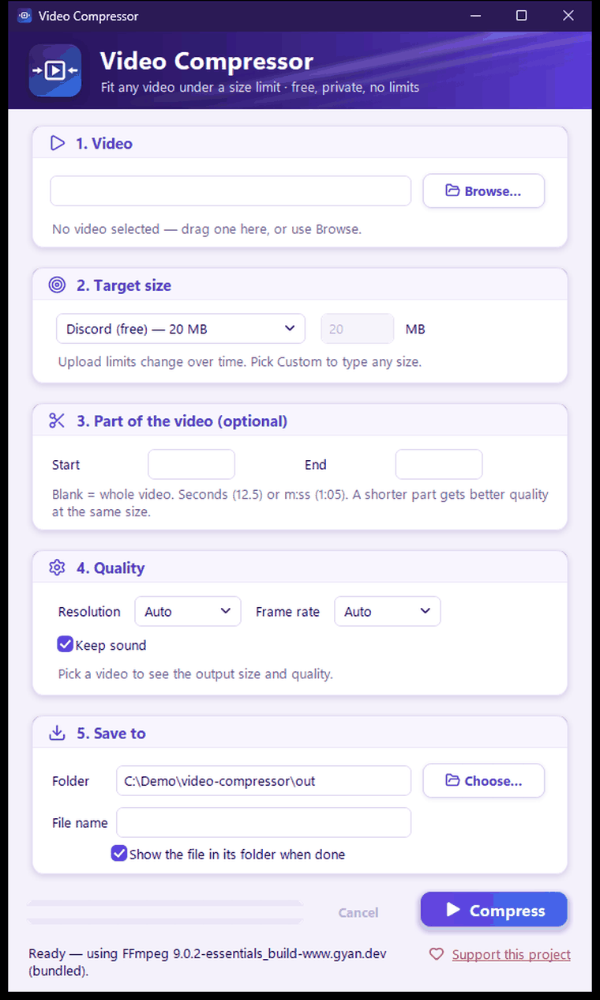

# Video Compressor

**Free, offline alternative to online video compressors. No upload limits, no watermark, no account.**



Shrinks a video to fit a file-size limit, such as Discord's upload limit or an email
attachment. Pick a size, click **Compress**, and the result lands just under it. Your video never
leaves your computer. Works on Windows and macOS.

## Download
Get the latest version from the [Releases page](https://github.com/collinb0607/video-compressor/releases/latest).
Nothing else to install: FFmpeg is built in.

| Your computer | Download | First launch |
|---|---|---|
| Windows 10/11 | `Video-Compressor-Windows.exe` | Windows may show "Windows protected your PC" because the app isn't signed. Click **More info**, then **Run anyway**. The first start takes a few seconds. |
| Mac with Apple Silicon (M1 or newer) | `Video-Compressor-macOS.zip` | Unzip, then open **Video Compressor**. macOS blocks it the first time because the app isn't notarized: open **System Settings → Privacy & Security**, scroll down and click **Open Anyway**. |

On an Intel Mac, or any other system, run it from source with Python (below).

## How it works
- **Drag and drop.** Drag a video onto the window, or click **Browse**.
- **Hits the size, not just "smaller".** File size is bitrate × length, so the app works out the
  exact bitrate for your target. It then encodes in **two passes**: the first studies the video,
  the second spends the bits where the picture needs them. Results land a few percent under the
  target. If one ever comes out over, the app re-encodes it lower automatically.
- **Never makes a video bigger.** The target is a ceiling. If the video (or the part you
  picked) already fits easily, the app stays close to its own quality instead of filling the
  target, so a 3 MB clip doesn't turn into a 19 MB one.
- **Picks a sensible resolution for you.** A 3-minute 1080p video squeezed into 20 MB would
  look blocky at full size, so **Auto** drops to the largest resolution and frame rate that
  still look clean at that bitrate (e.g. 720p, or 30 fps instead of 60). The **Output:** line
  shows exactly what you'll get before you start, and warns you if quality will be low.
  You can also set the resolution and frame rate yourself.
- **Plays everywhere.** Output is H.264 MP4 with AAC sound, which plays inline in Discord,
  on iPhone and Android, in browsers and in email.
- **Phone videos stay upright.** Portrait videos keep their orientation, and "720p" means
  720 pixels on the short side, for portrait and landscape alike.

## Options
| Option | What it does |
|---|---|
| Target size | Presets for Discord (free, 20 MB), Discord Nitro Basic (50 MB) and email (18 MB), or **Custom** to type any size. "MB" means 1,000,000 bytes, so the file fits however a site counts. |
| Part of the video | Optional start and end times (`12.5` or `1:05`). A shorter part gets better quality at the same size. |
| Resolution / Frame rate | **Auto** (recommended) or a fixed choice. Never upscales and never adds frames. |
| Keep sound | Turn off to give all the space to the picture. When space is tight the sound uses a lower bitrate (down to 64 kbps, still clear for speech). |
| Show the file in its folder | Opens the folder with the new file selected, ready to drag into a chat. |

**About the presets:** upload limits change. These were checked in November 2026: Discord's help
page lists 20 MB for free accounts, and Nitro Basic allows 50 MB. The email preset is 18 MB because
attachments grow by about a third when they're emailed, so 18 MB fits Gmail's and Outlook's 25 MB limit.
If a site's limit is different, pick **Custom**.

## Run from source (Python)
### Setup (one time)
1. Install **Python 3.8+** from https://python.org. On Windows, tick **"Add Python to PATH"** during install.
2. Run the app (see below). The first time, it asks **"Install FFmpeg?"** Click **Yes**. It downloads
   `imageio-ffmpeg`, which includes FFmpeg (about 30 MB), and `tkinterdnd2` for drag and drop.
   You won't be asked again.

### Run
```
python video_compressor.py        # Windows
python3 video_compressor.py       # macOS
```
On Windows you can also double-click `video_compressor.py`. If you have more than one Python
installed, double-clicking can run a different one from `python` in a terminal, so it may ask to
install FFmpeg once more. The install dialog shows which Python it installs into.

## Troubleshooting
- **"… MB is too small for … s of video":** below about 100 kbps, H.264 can't make a watchable
  picture at any size. The message says the smallest size that works. Use a shorter part, turn
  off sound, or raise the target.
- **"Quality will be low at this size":** the file will fit, but it will look blocky. A lower
  resolution, a shorter part or a bigger target will look better.
- **HDR videos (some iPhone and Android recordings):** the output is standard (SDR) H.264 so it
  plays everywhere, and colors can look a little washed out.
- **Something fails with no message:** errors are also written to `video_compressor_errors.log`
  in your temp folder. On Windows, paste `%TEMP%\video_compressor_errors.log` into File Explorer's
  address bar. On Mac, run `open $TMPDIR/video_compressor_errors.log`.

## Credits
The icons are from [Lucide](https://lucide.dev) (ISC license, see [assets/LUCIDE-LICENSE.txt](assets/LUCIDE-LICENSE.txt)).

## Support this project
This app is free, with no ads, accounts or limits. If it saved you time or a subscription, you can
support its development on Ko-fi:

[](https://ko-fi.com/collinbrooksdev)

## Part of the Offline Toolkit
Also by me: [GIF Maker](https://github.com/collinb0607/gif-maker), which turns a video into a GIF,
animated WebP, MP4 or WebM.
